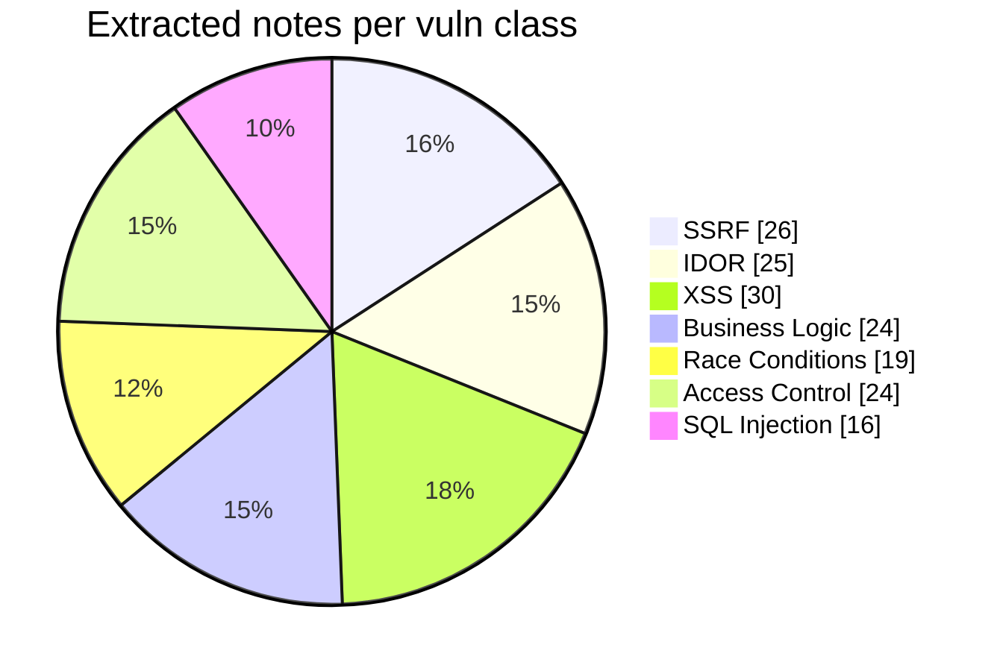

<div align="center">


[](https://github.com/AmanJ24/claude-bountycraft-skills)

<br/>


</div>

---

## What this is

A library of **reusable [Claude Code](https://claude.com/claude-code) skills, one per web vulnerability class.** Each skill is not paraphrased theory. It is distilled from real, disclosed bug bounty writeups (HackerOne reports, PortSwigger Research, Medium, Pentester Land) and then **validated against live PortSwigger labs** before it ships.

The goal: hand an agent (or a human hunter) a single lean file that teaches how to **recognize, test for, and report** a vuln class the way real hunters actually find it in the wild.

> [!NOTE]
> **Research phase only.** These skills produce methodology and guidance. They do not fire requests at live targets. Active, scope gated testing is a deliberate, later capability (see [Roadmap](#roadmap)), not part of this toolkit today.

---

## Skills at a glance

| Skill | Class | Status | Progress | Sources | Notes | Lab result |
|:------|:------|:------:|:---------|:-------:|:-----:|:-----------|
| 🛰️ **SSRF** | Server Side Request Forgery | ✅ Complete | `██████████` 100% | 30 | 26 | 4/5 green |
| 🔑 **IDOR** | Insecure Direct Object Ref | ✅ Complete | `██████████` 100% | 26 | 25 | **5/5 green** |
| 💉 **XSS** | Cross Site Scripting | ✅ Complete | `██████████` 100% | 31 | 30 | 4/5 green + 1 proven |
| 🧩 **Business Logic** | Price / workflow / payment | ✅ Complete | `██████████` 100% | 24 | 24 | 3/6 green |
| 🏁 **Race Conditions** | Single packet / TOCTOU | ✅ Complete | `██████████` 100% | 20 | 19 | technique proven |
| 🚪 **Access Control** | Auth bypass / privesc | ✅ Complete | `██████████` 100% | 24 | 24 | **5/5 green** |
| 🗄️ **SQL Injection** | In-band / blind / OOB / RCE | ✅ Complete | `██████████` 100% | 16 | 16 | 5/5 in-band green |

<sub>Lab results are PortSwigger labs driven end to end. "proven" / "technique proven" means the method was demonstrated but the final green banner was blocked by a harness limit (out of band callbacks, the single packet attack, or JS execution timeouts), not by a gap in the skill. Details live in each skill's `evals/` folder.</sub>

---

## The research pipeline

Every skill is built the same disciplined way. No shortcuts around sourcing.


| Step | What happens |
|:-----|:-------------|
| **1. Find** | Search Medium, HackerOne hacktivity, PortSwigger Research, Pentester Land for the class. |
| **2. Filter** | Keep writeups with real root cause and impact, ideally a disclosed report. Quality over quantity. |
| **3. Scrape** | Pull full text and metadata (title, author, URL, date, bounty) into `sources/`. |
| **4. Extract** | Distill each writeup into one paraphrased, structured note in `extracted/`. |
| **5. Synthesize** | Merge all notes into one lean `SKILL.md`, push bulky detail into `references/`. |
| **6. Test** | Run the skill against a matching PortSwigger lab. Does it actually help find the bug? |
| **7. Iterate** | Fix the gaps the eval surfaces, re run, then commit. |

---

## Coverage



---

## Anatomy of a skill

Each `SKILL.md` is kept lean and fast to load. Seven sections, always the same shape:

```
1. Recognize it            what the vuln looks like in the wild, common trigger points
2. Where it hides          feature types and parameters that tend to carry it
3. Test methodology        step by step approach to probing for it
4. Known bypass patterns   summarized, pointing to references/ for the full list
5. Common false positives  what looks like this vuln but is not
6. Reporting               how to write up impact convincingly once confirmed
7. Sources                 pointer to sources.md so every claim traces back
```

Bulky payload lists, edge cases, and longer examples live under each skill's `references/`.

---

## Repository layout

```
claude-bountycraft-skills/
├── sources/<class>/        raw scraped writeups (markdown, with source URL + date)
├── extracted/<class>/      one structured, paraphrased note per writeup
├── skills/<class>/
│   ├── SKILL.md            lean, distilled skill definition
│   ├── references/         detailed payloads, edge cases, longer examples
│   └── sources.md          full, credited source list for the skill
├── evals/<class>/          PortSwigger lab cases + recorded outcomes
└── progress.md             live status of every vuln class
```

| Directory | Role |
|:----------|:-----|
| `sources/` | The raw material. Every writeup that fed a skill, traceable to its original URL. |
| `extracted/` | The distillation. One note per writeup, paraphrased, following a fixed template. |
| `skills/` | The product. What an agent actually loads and applies. |
| `evals/` | The proof. Each skill run against a real lab, outcome recorded honestly. |

---

## Hard rules (non negotiable)

These keep the work both useful and clean.

- 🧪 **Research phase only.** Methodology and guidance. No requests to live targets.
- ✅ **Authorized scope only**, always, before any future active testing phase.
- 🚫 **No paywall bypassing.** Paywalled writeups are retrieved legitimately or flagged, never circumvented.
- ✍️ **Paraphrase, never copy.** Source text is distilled into our own words. Verbatim copying is checked for and removed.
- 🔗 **Track every source.** Title, author, URL, and the disclosed report link, so every claim can be traced and credited.

---

## Roadmap

```mermaid
gantt
    title Vuln class skills
    dateFormat X
    axisFormat %s
    section Shipped
    SSRF              :done, 0, 1
    IDOR              :done, 0, 1
    XSS               :done, 0, 1
    Business Logic    :done, 0, 1
    Race Conditions   :done, 0, 1
    Access Control    :done, 0, 1
    SQL Injection     :done, 0, 1
    section Backlog
    SSTI              :0, 1
    NoSQL Injection   :0, 1
```



**Phase 2 and 3 (future, gated):** assistive mode where a skill suggests an exact request for a human to fire manually, then a tightly controlled semi autonomous mode where the target is passed in explicitly each run, a scope file is checked before anything fires, and hard rate limits apply. Not built unless deliberately requested.

---

<div align="center">

<sub>Built as a practical AppSec toolkit and a portfolio signal. Methodology distilled from the people who actually found these bugs, credited in every <code>sources.md</code>.</sub>


</div>
